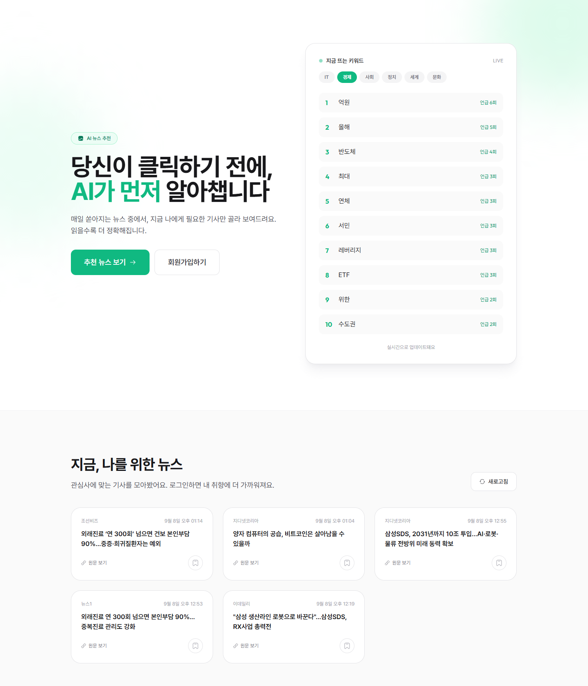
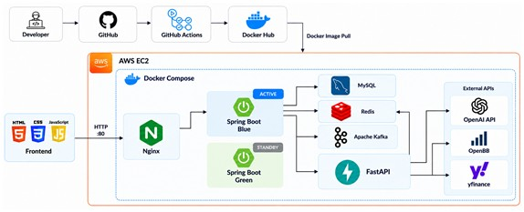
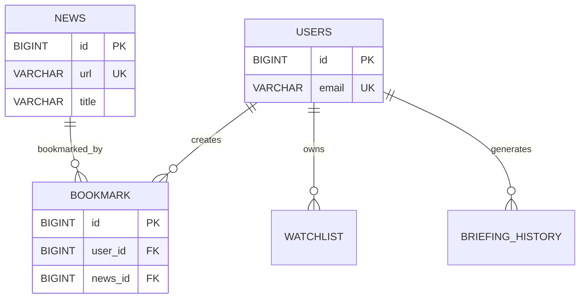

# VAP



AI 기반 뉴스 트렌드 분석 및 증시 정보 서비스

VAP는 뉴스와 금융 데이터를 한 곳에서 조회하고, 사용자 관심사와 종목 데이터를 바탕으로 개인화된 정보와 AI 분석을 제공하는 서비스입니다.

## 프로젝트 소개

VAP는 다음 두 영역으로 구성됩니다.

- **뉴스**: 뉴스 수집, 카테고리별 조회, 사용자 관심사 기반 추천, 키워드 추출 및 트렌드 분석
- **증시**: 국내·해외 지수와 종목 검색, 시세·재무·뉴스 조회, 종목 분석·비교 및 AI 브리핑

이 저장소에는 Spring Boot 백엔드와 FastAPI 기반 AI 서버가 포함되어 있습니다. 웹 프론트엔드는 별도 저장소인 `vp_front`에서 관리하며, 운영 환경에서는 Spring Boot가 정적 파일을 함께 서빙할 수 있습니다.

## 시스템 아키텍처



## 주요 기능

### 뉴스

- JWT 기반 회원가입·로그인
- 뉴스 카테고리별 조회 및 검색
- 사용자 관심사 기반 뉴스 추천
- 뉴스 북마크 및 클릭·활동 이벤트 수집
- Naver 뉴스 크롤링
- KeyBERT·SBERT 기반 키워드 추출
- Redis Sorted Set 기반 카테고리별 키워드 랭킹
- 비동기 뉴스 크롤링 작업 및 작업 상태 조회

### 증시

- 코스피, 코스닥, 코스피200, 나스닥, S&P500, 원/달러 환율 등 주요 지수 조회
- 국내·해외 종목 검색
- 종목별 시세, 차트, 재무, 기업정보 및 관련 뉴스 조회
- 관심종목 Watchlist 관리
- 2~5개 종목 비교
- 가격·거래량·재무 데이터를 이용한 종목 분석
- 관심종목 기반 AI 브리핑
- 금융 데이터 Provider 장애 시 대체 Provider 사용
- Redis 기반 캐시와 요청 제한

## 데이터 모델



대표 ERD는 아래 문서에서 확인할 수 있습니다.

- [ERD 상세 문서](docs/ERD.md)

## 기술 스택

### Backend

- Java 17
- Spring Boot 3.2.5
- Spring Web
- Spring Data JPA / Hibernate
- Spring Security
- JWT (`jjwt`)
- Spring Kafka

### AI Server

- Python
- FastAPI
- Uvicorn
- OpenBB
- yfinance
- OpenAI API
- KeyBERT
- Sentence-BERT
- KoNLPy / Okt
- Requests / BeautifulSoup / Selenium

### Data and Messaging

- MySQL 8.0
- Redis 7
- Apache Kafka 7.5, KRaft mode

### Infrastructure

- Docker Compose
- GitHub Actions
- Prometheus
- Grafana

## 프로젝트 구조

```text
vp_bank/
├── backend/                 # Spring Boot API 서버
│   └── src/main/java/        # Controller, Service, Repository, Kafka
├── ai/                       # FastAPI AI·크롤링·금융 데이터 서버
│   ├── analysis/             # 종목 분석, 비교, 브리핑, LLM
│   ├── market/               # OpenBB·yfinance 시장 데이터
│   └── crawler/              # 뉴스 크롤러
├── infra/                    # Docker Compose 및 운영 설정
├── docs/                     # 아키텍처 및 실험 문서
└── README.md
```

## 관련 문서

| 번호 | 문서 | 설명 |
|---:|---|---|
| 1 | [ERD 상세 문서](docs/ERD.md) | 사용자·뉴스·북마크·관심종목 데이터 구조 |
| 2 | [Backend 구조 설계](docs/BACKEND_DESIGN.md) | Backend 역할, 서비스 책임 및 데이터 흐름 |
| 3 | [AI Server 연동 구조](docs/AI_SERVER_INTEGRATION.md) | Spring Boot와 FastAPI AI Server 간 연동 흐름 |
| 4 | [뉴스 추천 구조](docs/NEWS_RECOMMENDATION.md) | 사용자 활동 기반 뉴스 추천 및 키워드 처리 |
| 5 | [금융 데이터 처리 구조](docs/FINANCIAL_DATA_PIPELINE.md) | 금융 데이터 Provider, 캐시 및 분석 흐름 |
